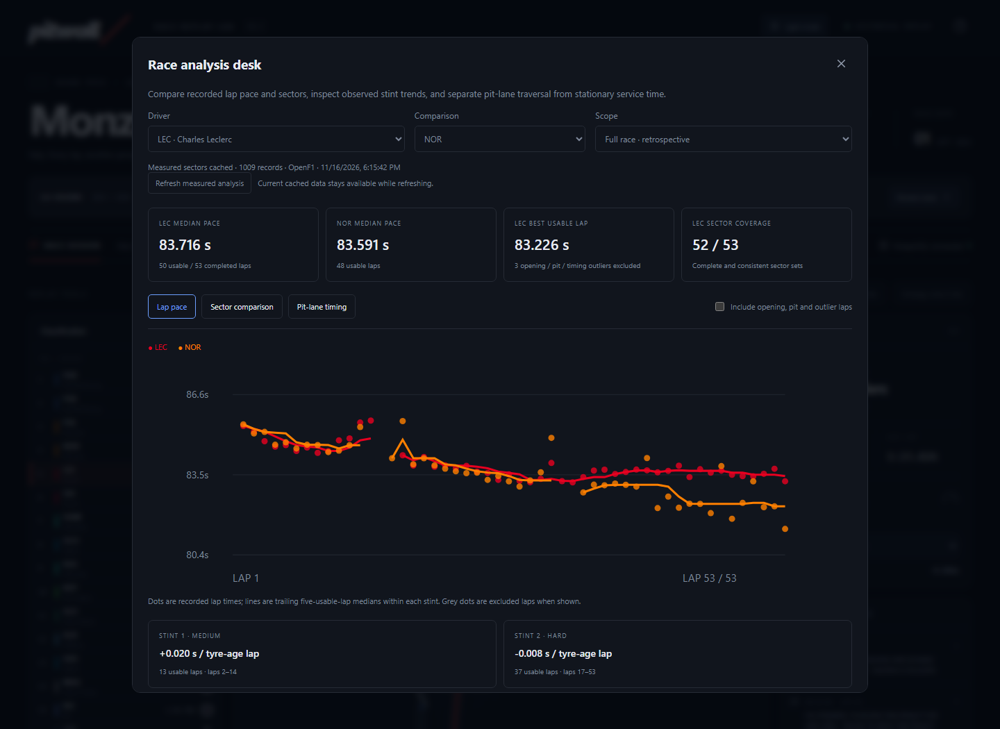
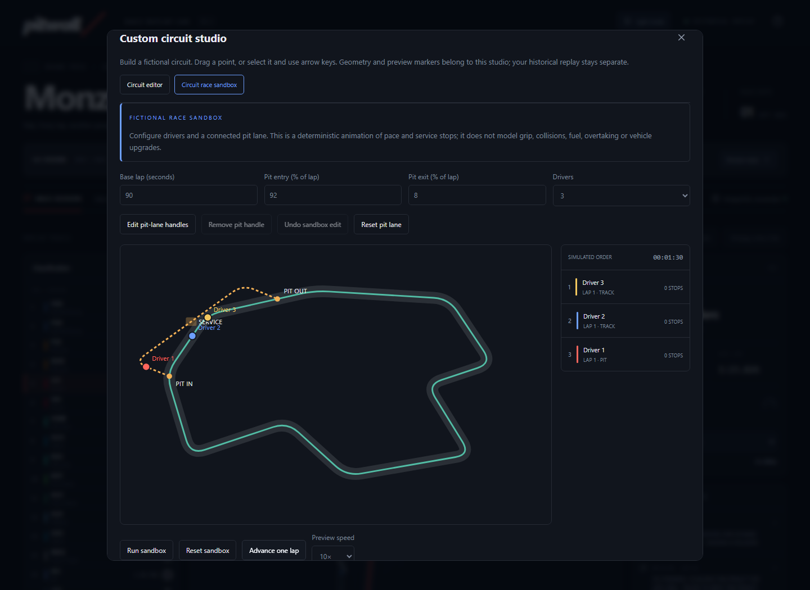

# Pitwall v1.3 — Race Replay Lab

An independent motorsport replay prototype built with React, TypeScript, ASP.NET Core 10, and PostgreSQL 17. Start with recorded races; later, branch into player-controlled strategy simulations.

[Complete user guide](docs/USER-GUIDE.md) · [Three-minute demo](docs/DEMO.md) · [v1.3 release notes](docs/V1.3.md) · [Testing](docs/TESTING.md) · [Roadmap](docs/FOLLOW-UP-PLAN.md)

The [handbook](docs/USER-GUIDE.md) documents every current user flow: steps, defaults, saved data, exports, resets and recovery. For future upgrades, follow [CONTRIBUTING](CONTRIBUTING.md) and update the affected flows alongside the implementation. CI checks the registry, links, required sections, UI component coverage and product version.

## What works now

- A searchable historical library covering completed Grand Prix and Sprint sessions exposed by OpenF1 from 2023 onward. The current catalog lists 114 non-cancelled sessions, through Interlagos on 8 November 2026.
- Season and session filters, latest-race highlighting, and explicit cached/import states.
- Bundled Monza 2024 and Interlagos 2026 replays. Other sessions import on demand and persist in PostgreSQL.
- Play/pause, 1×–50× playback, timeline scrubbing, lap jumps, and keyboard controls.
- Driver focus, last-lap comparisons, and clickable tyre-strategy strips.
- Original SVG circuit outline, bundled recorded positions for Monza 2024, and on-demand recorded-position upgrades for other races where coverage permits.
- Interactive circuit map: zoom, drag to pan, selected-driver follow mode, driver visibility, labels/grid controls, and browser-saved layouts per race.
- Recorded driver trails for the focused comparison pair, split across telemetry gaps and rebuilt when seeking.
- Shareable replay moments that restore race/time, driver comparison, playback speed, and position source, paused.
- Up to ten named map layouts per race, alongside the existing saved default view.
- A custom circuit studio with draggable control points, adjustable rounded corners, undo/redo, ordered sectors, local saves, validated JSON imports/exports, and a marker preview that follows the curves.
- A strategy what-if lab with two editable plans, robust recent-lap pace sampling, projected time differences, saved scenarios, and JSON exports. This is an explicit experimental model, not a finishing-position predictor.
- A race analysis desk with measured sectors, speed-trap readings, lap-pace charts, observed stint trends, pit-lane/service timing, replay-scope filters and CSV/JSON exports.
- Approximate sector markers aligned to a completed lap's recorded sector clock and location samples; missing references stay hidden.
- A held-out pace backtest comparing past-only flat and trend baselines with later recorded laps, with explicit errors and pit-free/data-quality requirements.
- A circuit race sandbox with editable connected pit lanes, one to six named/coloured drivers, individual pace, scheduled service stops, a simulated running order and browser-saved setups.
- Finite 1–50 lap fictional races with exact finish times/results, plus selected-driver live pit calls, cancellation before entry and repeat visits. See [race sessions](docs/guide/05-race-sandbox.md#sandbox-08).
- Private multiplayer rooms with a C#-owned simulation clock, SignalR snapshots, guest driver claims/readiness, host controls, live pit calls, reconnect, spectator support, guest removal and driver/host handover. Rooms are temporary and use one API instance. See [the multiplayer guide](docs/guide/07-multiplayer.md).
- Fictional driver recruitment: generated stat-based prospects, a 12,000-credit budget, six-driver roster, custom 210-point builds, two swappable race seats, browser persistence and lineup application to local/new multiplayer races. See [recruiting flows](docs/guide/08-driver-recruitment.md).
- On-demand tool bundles, recovery from tool download failures, indexed replay lookups, a read-only setup doctor, and a one-command local preview.
- Light/dark themes with a header toggle, system preference on first visit, and a browser-saved choice across races.
- Save, revisit, and delete replay moments. Bookmarks are isolated by race and survive API restarts in PostgreSQL.
- Database migrations, Docker Compose, integration tests, browser tests, and GitHub Actions.

## Run the whole app with Docker

Prerequisites: Docker Desktop running with the Linux engine; Node 24 for the one-time environment setup.

```powershell
node scripts/setup-env.mjs
docker compose up --build -d
docker compose ps
```

Open **http://localhost:8080**. The interface should say **PostgreSQL connected**.

The setup script creates an ignored `.env` with a random development database password. It never overwrites an existing file. The database is published only to `127.0.0.1:55432` and the app only to `127.0.0.1:8080`.

See [the Docker walkthrough](docs/DOCKER.md) to understand images, containers, ports, volumes, logs, and development mode.

For an already-built Windows checkout, `node scripts/doctor.mjs` checks installed tools, build files, database reachability and running previews without printing credentials. `node scripts/preview.mjs` serves the built frontend and API together at **http://127.0.0.1:5080**, reading the same local `.env`. Use `--snapshot` for temporary storage or `--port 5082` for a different local port. It checks prerequisites before starting and recognizes an existing Pitwall process instead of stopping it.

## Develop with hot reload

Prerequisites: Node 24, .NET 10 SDK, Docker Desktop. A system PostgreSQL installation is unnecessary when using the container.

```powershell
node scripts/setup-env.mjs
docker compose up -d db
```

Terminal 1, from the repository root:

```powershell
./scripts/dev-api.ps1
```

Terminal 2:

```powershell
cd frontend
npm ci
npm run dev
```

Open **http://localhost:5173**. Vite proxies `/api` requests to the C# backend on port 5080.

For a preview without PostgreSQL, run `./scripts/dev-api.ps1 -Snapshot`. The race still works, but bookmarks are temporary and shared in API memory. Snapshot mode is explicitly labeled in the interface.

## Validate

See [the testing guide](docs/TESTING.md) for current browser coverage, deterministic provider fixtures, and failure reports.

```powershell
node scripts/check-docs.mjs
dotnet build backend/Pitwall.Api/Pitwall.Api.csproj -c Release
python scripts/test-api.py
cd frontend
npm ci
npm test
npm run build
npx playwright install chromium
npm run test:e2e
```

Python 3.12+ is required for API integration tests. The PostgreSQL integration test is `python scripts/test-api.py --postgres` with `ConnectionStrings__Pitwall` set. CI supplies a disposable PostgreSQL service and verifies persistence across an API restart. Tests create and delete their own bookmark; they do not reset the database.

Browser tests exercise the production frontend build. Stop other development servers before running them when you want isolated test processes.

## Data and accuracy

### Customize the map

Use **+ / −** to zoom or **Fit circuit** to reset the camera. Drag the map to pan; Ctrl + scroll zooms around the pointer. With the map focused, arrow keys pan, `+`/`−` zoom, and Home fits the circuit. These map shortcuts do not seek playback.

**Follow** centers the view on the selected driver's interpolated marker. Manual camera movement exits follow mode. Open **Drivers & view** to select visible drivers, focus on the selected comparison pair, and change labels or the grid. Selecting a different driver reveals their marker if it was hidden.

**Save layout** stores the current camera and display settings in this browser, separately for each race. These are local preferences, not account-synchronized settings; follow mode itself is temporary. **Restore defaults** resets the current view settings; save afterward if you want those defaults to replace your saved layout.

See [the follow-up plan](docs/FOLLOW-UP-PLAN.md) for the sequence of replay fidelity, custom tracks, strategy, and later upgrades.

### Use the v1.2 tools

The **Replay tools** row opens **Share moment**, **Custom circuit studio**, and **Strategy what-if lab**. See [the v1.2 guide](docs/V1.2.md) for a walkthrough and model limitations.

Choose **Driver trails** beside the position-source selector for 15–60 seconds of recorded history for the visible selected/comparison drivers. Trails do not appear in lap-estimate mode, do not join missing-data intervals, and contain no future samples after a seek.

Open **Drivers & view** to save, load, replace by name, or delete named map layouts. These store camera, visibility, labels, grid and sector-marker preferences in this browser for this race. **Save layout** still sets the default view used when reopening the race. Named layouts, custom circuits, and strategy scenarios do not yet sync across devices.

### Use the v1.3 tools

Open **Race analysis desk** for lap pace, measured sector comparison and pit-lane timing. Choose **Replay so far** to exclude later laps, or **Full race** for retrospective analysis. Monza's measured analysis is bundled; other cached races use **Load measured analysis**. A refresh keeps current data available until a replacement succeeds. Missing sectors and stationary stop times remain empty. Pit-lane duration is not net race-time loss.

Under **Drivers & view**, enable **Recorded sector markers** in recorded-position mode. Markers use the first suitable completed reference lap for the selected driver and disappear if timing/location coverage cannot support them. These are approximate crossing coordinates, not surveyed circuit boundaries.

Open **Pace forecast backtest** to train on earlier laps and evaluate a later pit-free window. This checks two simple pace baselines, not the outcome of an unobserved pit decision. In **Custom circuit studio → Circuit race sandbox**, configure a pit lane and driver grid, then run or fast-forward the fictional preview. All geometry and fictional driver settings stay separate from historical replay data.





Open **Browse races** to search the archive, filter seasons or Sprint/Grand Prix sessions, and select a replay. The default view opens the newest cached race. A first-time import runs in a background queue; progress is visible, closing the library does not cancel the server import, and later visits read the cached replay. The catalog is a list of provider sessions, not a promise that every session has complete telemetry. Missing or unusable timing returns a clear error.

The catalog refreshes automatically when older than 12 hours, checked hourly while the backend runs. **Check for new races** requests an immediate refresh. If the provider is unavailable, the existing catalog and cached races remain available. Imports and catalog refreshes share a single worker gate with paced API requests; multiple server replicas would need a shared queue/rate limiter before scaling ingestion horizontally.

Node 24 runs the ingestion worker alongside C#. The Docker image includes it; local API development requires Node on PATH. SQL migration `002_catalog` persists refreshed catalogs. No provider requests are needed for already cached replay playback.

Measured analysis is an independent enrichment inside the cached replay JSON. It can be loaded/refreshed without replacing timing or map coordinates; concurrent writes preserve analysis, locations and bookmarks. `POST /api/sessions/{id}/analysis` queues enrichment for an already cached race, `GET` on that path reports status, and `POST .../analysis?refresh=true` requests a refresh. The worker uses the same bounded queue and provider pacing as replay imports. The CLI command `node scripts/import-race.mjs --session 9590 --analysis` writes a separate bundle under `data/analysis/`.

Import a specific session manually with `node scripts/import-race.mjs --session 11412`, or refresh the bundled catalog with `node scripts/import-race.mjs --catalog`. These write snapshots into `data/`; rebuild the API afterward to bundle them. Normal UI imports are stored in PostgreSQL instead.

The bundled snapshots were imported from [OpenF1](https://openf1.org/): session **9590** (Monza, 1 September 2024) and **11412** (Interlagos, 8 November 2026). Routine builds and automated tests do not query the provider. Live imports and catalog refreshes require network access.

Lap times, classification messages, stints, and race-control messages are recorded data. The circuit outline comes from one recorded lap's coordinates.

### Recorded-position pilot: Monza 2024

**Position source** defaults to recorded mode when traces are cached. Monza's 20 bundled driver traces contain about 91,000 retained coordinates, using the same UTC origin and spatial projection as the race clock and outline. We retain at most one provider sample per second and linearly smooth between neighboring samples only when they are at most 2.5 seconds apart. Binary search supports playback and seeking in either direction.

OpenF1 describes its locations as approximate. These are not lane-accurate GPS, and the visualization does not establish exact braking points or physical separation. Missing drivers, out-of-frame/invalid samples, and long gaps do not silently become lap estimates: recorded markers disappear and the selected driver's status says **location gap**. Follow mode cannot start without a usable selected-driver location; it holds its previous camera position during a later gap.

**Lap estimate** remains an explicit alternative. It moves markers uniformly around the outline using lap duration, and is the default for races without recorded traces. Switching source does not seek the replay. The selected source currently resets to the race's available default when reopening it; saved map layouts still contain only camera/display preferences.

For other races, choose **Load recorded positions** below the source selector. Imports queue in the background, can take several minutes, and keep the current replay usable. Successful upgrades preserve replay time, driver selection, camera, and bookmarks, then switch the map to recorded mode. Failed or empty coverage keeps the timing replay and offers a retry. Leaving the race stops the browser's wait; the server job continues and a later visit can use the cached result. PostgreSQL retains upgrades across restarts; snapshot mode retains them only for the current API process. An older timing import cannot downgrade a richer cached replay.

The location API uses `POST /api/sessions/{id}/locations` to queue or reconnect to a job and `GET` on the same route to inspect it. Responses expose `queued`, `running`, `completed`, or `failed`; cached location upgrades return completed without a provider request. Duplicate requests share one job per session. Queue capacity is eight, with one active worker.

To rebuild a bundled snapshot, run `node scripts/import-race.mjs --session 9590 --locations`, then rebuild/restart the API. The CLI caches raw location responses under ignored `.cache/provider/` files so interrupted CLI imports can resume. Routine library imports start with timing only; the separate location action upgrades the database without rewriting bundled JSON. Bundled payload revisions also upgrade older PostgreSQL replays without deleting bookmarks. JSON responses are compressed for playback delivery.

Classification messages arrive asynchronously and may temporarily repeat positions; ties use lap progress. Missing timed laps can pause a marker. Last-lap comparisons may compare different lap numbers. The strategy strip deliberately reveals full-race stints.

This is an educational, independent prototype, not an official Formula 1 product. It includes no broadcasts, team logos, driver photographs, or audio. Open-source software access does not establish commercial rights to underlying data or trademarks. Check [OpenF1's usage guidance](https://openf1.org/) and [Formula 1's guidelines](https://www.formula1.com/en/information/guidelines.4EOKE9RRqevL4niTK9kWyt) before commercial use.

## Structure

```text
frontend/                 React app, timing engine, unit/browser tests
backend/Pitwall.Api/       C# API, PostgreSQL storage, SQL migrations
data/                     Bundled historical replay
scripts/                  Data import, environment setup, API checks
.github/workflows/ci.yml   Test, build, and container delivery
compose.yaml              Local app + PostgreSQL orchestration
Dockerfile                Multi-stage production build
```

## CI and delivery

Branch workflow: `master` consolidates the completed work, `develop` is available for integration, and `feature/*` branches hold individual changes. Open pull requests from feature branches into `develop`, then promote tested releases to `master`. CI supports `main`, `master`, `develop`, feature branch pushes, and pull requests. The push helper accepts branch names, for example `node scripts/push-github.mjs master`.

For the first push from your own Windows terminal, `node scripts/push-github.mjs` handles the sandbox folder ownership check for that command and requests a fresh GitHub device-code sign-in through Git Credential Manager. Open the displayed verification page in your preferred browser. The helper isolates this repository's credential namespace; it does not read credentials, change global Git trust, or erase credentials for other repositories.

Pull requests and configured branch pushes run timing tests, production builds, PostgreSQL integration checks, and browser tests. A second job builds the full Docker image. Successful `main` or `master` builds publish `latest` and commit-SHA tags to `ghcr.io/<owner>/<repository>` using GitHub's built-in token.

This is **continuous integration and image delivery**, not deployment to a live hosting service. No deployment host or credentials are configured. Hosted CI for each new release is verified after its authenticated push.

## Next milestones

1. Add player-triggered pit decisions and tyre changes to the fictional sandbox, then validate more of the strategy assumptions.
2. Evaluate pace models across multiple historical windows and sessions, retaining data-quality exclusions and failure cases.
3. Add authentication and private user bookmarks when cross-device use is needed.
4. Add portable sandbox-session imports and richer circuit libraries before multiplayer or public sharing.
5. Plan upgrades and team progression; car designs, 3D models, and detailed upgrade models are deferred.

The present API is for local development: bookmarks are shared and have no account ownership or authorization. Add accounts, authorization, rate limits, and a production database backup plan before opening a multi-user service.
