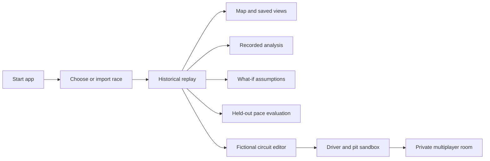
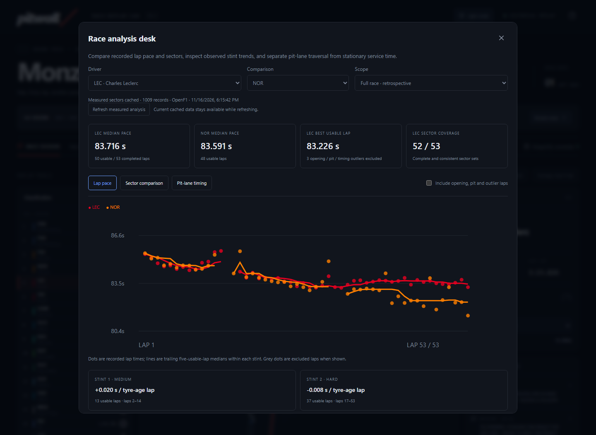

# Pitwall user guide

**Product version:** 1.3.0

**Last reviewed:** 2026-11-21

This is the current handbook for what each flow does, how to use it, what is saved, and how to recover. The [three-minute demo](DEMO.md) is a quick tour; release notes describe historical changes. This guide describes the current app.

## Start here

1. [Run Pitwall and find a race](guide/01-start-library.md).
2. [Explore replay, moments and map controls](guide/02-replay-map.md).
3. [Use analysis, hypothetical strategy and backtesting](guide/03-analysis-strategy.md).
4. [Design and save a fictional circuit](guide/04-circuit-studio.md).
5. [Configure drivers and pit stops in the race sandbox](guide/05-race-sandbox.md).
6. [Understand storage, maintenance and guide updates](guide/06-maintenance.md).
7. [Host, join and hand over a private multiplayer race](guide/07-multiplayer.md).

Each flow has a stable ID, a **What**, **How**, **Result and storage**, and **Recovery and limits** section. Use these IDs in issues and pull requests instead of relying on a screenshot or an old chat.

## Which workspace should I use?

| Your question | Open | Meaning |
| --- | --- | --- |
| What happened during a real race? | Historical replay | Recorded timing with explicitly selected recorded/estimated map movement |
| Where did drivers gain or lose time? | Race analysis desk | Descriptive historical analysis; full race or replay-so-far scope |
| What if these pace/pit assumptions were different? | Strategy what-if lab | Deterministic comparison of supplied assumptions |
| How well do past-only pace baselines match later laps? | Pace forecast backtest | Held-out pace evaluation, not proof of an unobserved pit decision |
| Can I design my own circuit? | Custom circuit studio → Circuit editor | Fictional geometry, separate from real replays |
| Can I run a custom grid with scheduled stops? | Circuit race sandbox | Fictional pace/route/service animation |
| Can friends control drivers in the same race? | Multiplayer rooms | One server-owned fictional race with guest driver ownership |

## Save and export boundaries

Saving to PostgreSQL, saving in your browser and downloading a file are different actions. [OPS-01](guide/06-maintenance.md#ops-01) gives the complete storage matrix.

| Artifact | Reopen through current UI? | Important boundary |
| --- | --- | --- |
| Default/named map layout | Yes, same browser origin and race | Camera/display only; no source/trails/follow state |
| Replay bookmark | Yes, same server/race | Shared development data; durable only with PostgreSQL |
| Saved circuit and sandbox setup | Yes, same browser origin and circuit ID | Setup reopens a fresh run, not its old clock/order |
| Saved strategy scenario | Yes, same browser origin and race | Pace is recalculated from available replay data |
| Circuit JSON export | Yes, import/review/save in circuit editor | Geometry/definition only, not pit/driver setup |
| Strategy/backtest/analysis JSON or analysis CSV | No dedicated importer | Inspection/export artifacts |
| Combined sandbox session JSON | No session importer yet | Contains geometry/setup/runtime for inspection |
| Share link | Yes, if its server/session is available | Encodes replay settings, not private saves or custom workspaces |
| Multiplayer room | Reconnect while that API process retains it | Guest token in tab session storage; rooms are in server memory even with PostgreSQL |

Closing a studio or scenario without saving can lose its draft. Clearing browser data, changing browser/profile, or using another hostname/port can change which browser saves you see. A normal database-backed API restart does not erase server caches/bookmarks.

## Keyboard and focus reference

| Focus/context | Action |
| --- | --- |
| Main replay, outside form controls and tools | Space: play/pause; left/right: seek 15 seconds |
| Focused replay map | Arrows: pan; `+`/`=`/`−`: zoom; Home: fit |
| Mouse over replay map | Drag: pan; Ctrl/Command + wheel: zoom |
| Focused race timeline | Native range controls, including Home/End to its bounds |
| Focused circuit editor canvas | Arrows: move selected point 2 units; Shift + arrows: 10; Delete/Backspace: remove |
| Focused sandbox canvas while editing pit handles | Arrows: move selected handle; Shift for larger steps |
| Numeric tool fields | Valid entries apply; Enter/blur commits bounded values |
| Tool dialog | Tab follows its controls; Escape/close button exits |

## Complete flow index

<!-- flow-index:start -->
<!-- Generated by scripts/update-guide-index.mjs. -->

76 documented flows. Each ID links directly to its instructions.

### Start Pitwall and choose a race

| Flow | What you can do |
| --- | --- |
| [START-01](guide/01-start-library.md#start-01) | Run the complete app in Docker |
| [START-02](guide/01-start-library.md#start-02) | Develop with hot reload |
| [START-03](guide/01-start-library.md#start-03) | Run an already-built local preview |
| [START-04](guide/01-start-library.md#start-04) | Diagnose the local setup |
| [START-05](guide/01-start-library.md#start-05) | Choose light or dark mode |
| [START-06](guide/01-start-library.md#start-06) | Recover from a load or tool failure |
| [LIB-01](guide/01-start-library.md#lib-01) | Search and filter the race library |
| [LIB-02](guide/01-start-library.md#lib-02) | Open a cached race |
| [LIB-03](guide/01-start-library.md#lib-03) | Import an uncached race |
| [LIB-04](guide/01-start-library.md#lib-04) | Check for new completed races |

### Replay, moments and map controls

| Flow | What you can do |
| --- | --- |
| [REPLAY-01](guide/02-replay-map.md#replay-01) | Play, pause and restart |
| [REPLAY-02](guide/02-replay-map.md#replay-02) | Seek by time or lap |
| [REPLAY-03](guide/02-replay-map.md#replay-03) | Focus and compare drivers |
| [REPLAY-04](guide/02-replay-map.md#replay-04) | Revisit a race-control event |
| [REPLAY-05](guide/02-replay-map.md#replay-05) | Inspect tyre stints |
| [REPLAY-06](guide/02-replay-map.md#replay-06) | Save, revisit and delete a moment |
| [REPLAY-07](guide/02-replay-map.md#replay-07) | Share a replay moment |
| [REPLAY-08](guide/02-replay-map.md#replay-08) | Read data notes and source limitations |
| [REPLAY-09](guide/02-replay-map.md#replay-09) | Expand the circuit workspace |
| [MAP-01](guide/02-replay-map.md#map-01) | Choose recorded or estimated positions |
| [MAP-02](guide/02-replay-map.md#map-02) | Load recorded positions |
| [MAP-03](guide/02-replay-map.md#map-03) | Zoom, pan and fit |
| [MAP-04](guide/02-replay-map.md#map-04) | Follow the selected driver |
| [MAP-05](guide/02-replay-map.md#map-05) | Choose visible drivers |
| [MAP-06](guide/02-replay-map.md#map-06) | Set labels, grid and defaults |
| [MAP-07](guide/02-replay-map.md#map-07) | Save the default map view |
| [MAP-08](guide/02-replay-map.md#map-08) | Save, load, replace or delete a named layout |
| [MAP-09](guide/02-replay-map.md#map-09) | Display recorded driver trails |
| [MAP-10](guide/02-replay-map.md#map-10) | Display approximate sector crossings |

### Analysis, hypothetical strategy and backtesting

| Flow | What you can do |
| --- | --- |
| [ANALYSIS-01](guide/03-analysis-strategy.md#analysis-01) | Choose drivers and analysis scope |
| [ANALYSIS-02](guide/03-analysis-strategy.md#analysis-02) | Interpret pace and stint trends |
| [ANALYSIS-03](guide/03-analysis-strategy.md#analysis-03) | Compare measured sectors |
| [ANALYSIS-04](guide/03-analysis-strategy.md#analysis-04) | Inspect measured pit visits |
| [ANALYSIS-05](guide/03-analysis-strategy.md#analysis-05) | Load or refresh measured analysis |
| [ANALYSIS-06](guide/03-analysis-strategy.md#analysis-06) | Inspect rows and jump back to replay |
| [ANALYSIS-07](guide/03-analysis-strategy.md#analysis-07) | Export analysis data |
| [STRATEGY-01](guide/03-analysis-strategy.md#strategy-01) | Choose the hypothetical branch and horizon |
| [STRATEGY-02](guide/03-analysis-strategy.md#strategy-02) | Edit Plans A and B |
| [STRATEGY-03](guide/03-analysis-strategy.md#strategy-03) | Read the model result |
| [STRATEGY-04](guide/03-analysis-strategy.md#strategy-04) | Save and load named scenarios |
| [STRATEGY-05](guide/03-analysis-strategy.md#strategy-05) | Delete or export a strategy scenario |
| [BACKTEST-01](guide/03-analysis-strategy.md#backtest-01) | Choose past training and future evaluation laps |
| [BACKTEST-02](guide/03-analysis-strategy.md#backtest-02) | Find an eligible sample |
| [BACKTEST-03](guide/03-analysis-strategy.md#backtest-03) | Interpret and export forecast errors |
| [BACKTEST-04](guide/03-analysis-strategy.md#backtest-04) | Open the branch in replay |

### Design a custom circuit

| Flow | What you can do |
| --- | --- |
| [STUDIO-01](guide/04-circuit-studio.md#studio-01) | Start a new circuit or copy an outline |
| [STUDIO-02](guide/04-circuit-studio.md#studio-02) | Add, move and remove control points |
| [STUDIO-03](guide/04-circuit-studio.md#studio-03) | Undo and redo structural edits |
| [STUDIO-04](guide/04-circuit-studio.md#studio-04) | Set start/finish and sector order |
| [STUDIO-05](guide/04-circuit-studio.md#studio-05) | Round circuit corners |
| [STUDIO-06](guide/04-circuit-studio.md#studio-06) | Run the simple marker preview |
| [STUDIO-07](guide/04-circuit-studio.md#studio-07) | Save and load a circuit |
| [STUDIO-08](guide/04-circuit-studio.md#studio-08) | Delete a saved circuit |
| [STUDIO-09](guide/04-circuit-studio.md#studio-09) | Import or export circuit JSON |

### Configure and run a fictional race

| Flow | What you can do |
| --- | --- |
| [SANDBOX-01](guide/05-race-sandbox.md#sandbox-01) | Enter the sandbox and switch studio views |
| [SANDBOX-02](guide/05-race-sandbox.md#sandbox-02) | Configure the grid and driver pace |
| [SANDBOX-03](guide/05-race-sandbox.md#sandbox-03) | Attach and edit the pit lane |
| [SANDBOX-04](guide/05-race-sandbox.md#sandbox-04) | Run, pause and advance the fictional race |
| [SANDBOX-05](guide/05-race-sandbox.md#sandbox-05) | Undo, reset the lane or reset the run |
| [SANDBOX-06](guide/05-race-sandbox.md#sandbox-06) | Save and reopen a circuit/race setup |
| [SANDBOX-07](guide/05-race-sandbox.md#sandbox-07) | Export a sandbox session |
| [SANDBOX-08](guide/05-race-sandbox.md#sandbox-08) | Choose a race distance and read final results |
| [SANDBOX-09](guide/05-race-sandbox.md#sandbox-09) | Make and cancel live pit calls |

### Storage, validation and keeping the guide current

| Flow | What you can do |
| --- | --- |
| [OPS-01](guide/06-maintenance.md#ops-01) | Know where data lives |
| [OPS-02](guide/06-maintenance.md#ops-02) | Validate a change locally |
| [OPS-03](guide/06-maintenance.md#ops-03) | Publish branches and verify CI |
| [OPS-04](guide/06-maintenance.md#ops-04) | Restart, update or recover the running app |
| [OPS-05](guide/06-maintenance.md#ops-05) | Update this guide with each behavior change |

### Private multiplayer races

| Flow | What you can do |
| --- | --- |
| [ROOM-01](guide/07-multiplayer.md#room-01) | Create a private race room |
| [ROOM-02](guide/07-multiplayer.md#room-02) | Invite friends and join as a guest |
| [ROOM-03](guide/07-multiplayer.md#room-03) | Claim a driver, spectate and get ready |
| [ROOM-04](guide/07-multiplayer.md#room-04) | Make shared live pit decisions |
| [ROOM-05](guide/07-multiplayer.md#room-05) | Control the race as host |
| [ROOM-06](guide/07-multiplayer.md#room-06) | Hand over a driver without resetting |
| [ROOM-07](guide/07-multiplayer.md#room-07) | Reconnect, leave and remove guests |
| [ROOM-08](guide/07-multiplayer.md#room-08) | Run a two-player trial and prepare outside access |
<!-- flow-index:end -->

## How this stays current

The [flow registry](flows.json) connects each section to its implementation. [CONTRIBUTING](../CONTRIBUTING.md), repository agent instructions and the pull-request checklist require behavior changes to update the corresponding flow. `node scripts/check-docs.mjs` checks structural coverage, local links/anchors, source references, classified UI components and product-version consistency in CI.

Checks do not replace human review of actual defaults, labels, save/reset behavior and failures. New or changed flows are reviewed with the implementation, not inferred from release notes. See [OPS-05](guide/06-maintenance.md#ops-05).
